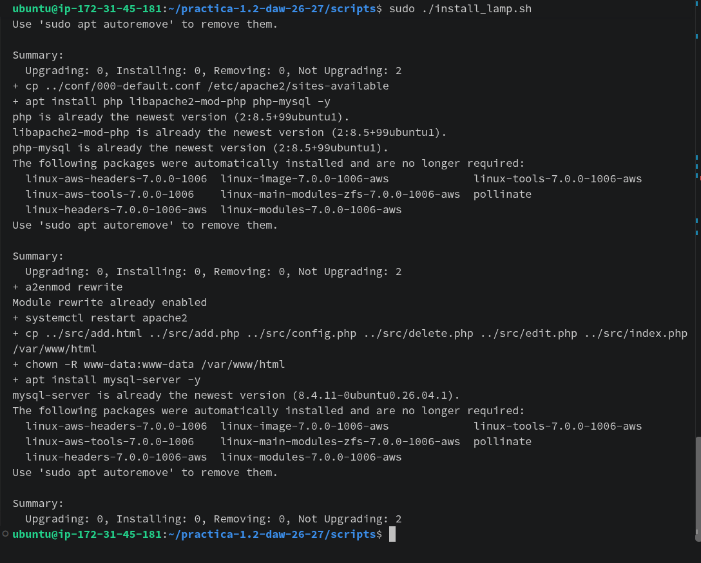
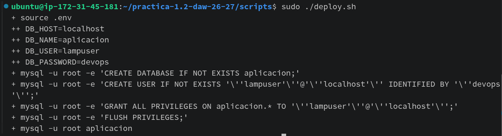
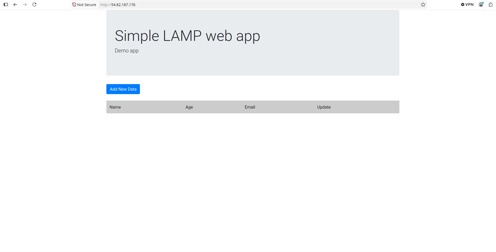

 
# practica-1.2-daw-26-27
Prácticas del ciclo de Desarrollo de Aplicaciones Web (DAW), curso 2026-2027.

>IES Celia Viñas (Almería) - Curso 2020/2021  
>Módulo: IAW - Implantación de Aplicaciones Web  
>Ciclo: CFGS Administración de Sistemas Informáticos en Red  

Esta práctica consiste en un sistema **muy básico** para añadir, editar, borrar y ver registros de una base de datos, haciendo uso de [PHP][1] y [MySQL][2].

## Instalación y despliegue

La aplicación sigue la arquitectura LAMP de la [práctica propuesta](https://github.com/josejuansanchez/iaw-practica-lamp): Linux como sistema operativo, Apache como servidor web, MySQL como gestor de base de datos y PHP para ejecutar la aplicación. Para realizar estos pasos se necesita un equipo o máquina virtual con Ubuntu, conexión a Internet y una cuenta con permisos `sudo`.

### 1. Instalar el servidor LAMP y copiar la aplicación

Clona o copia este repositorio en el servidor. Desde la carpeta del proyecto, ejecuta el script de instalación:

```bash
cd practica-1.2-daw-26-27/scripts
sudo ./install_lamp.sh
```

El script actualiza los paquetes, instala Apache, PHP y el módulo de PHP para MySQL, habilita `rewrite`, configura el sitio de Apache, copia los archivos PHP a `/var/www/html`, asigna los permisos al usuario `www-data` e instala MySQL Server.



### 2. Configurar la base de datos

El archivo `scripts/.env` contiene los parámetros de conexión usados por el despliegue. Comprueba que `DB_NAME`, `DB_USER` y `DB_PASSWORD` coincidan con los valores definidos en `src/config.php`. Antes de publicar el servidor, cambia las credenciales de ejemplo y protege el archivo `.env`.

Desde la carpeta `scripts`, ejecuta el despliegue:

```bash
sudo ./deploy.sh
```

Este script crea la base de datos y el usuario configurados, concede los permisos necesarios e importa `db/database.sql`, que crea la tabla `users`.



### 3. Comprobar la aplicación

Abre en un navegador [http://54.82.187.176/](http://54.82.187.176/) (o `http://localhost/` si el navegador está en el propio servidor). Debe mostrarse la página de la aplicación, desde la que se pueden consultar y gestionar los registros.



## Créditos

El código utilizado en esta práctica está basado en el repositorio [crud-php-simple][3] de [@chapagain][4].

[1]: http://www.php.net
[2]: https://www.mysql.com
[3]: https://github.com/chapagain/crud-php-simple
[4]: https://github.com/chapagain

  
